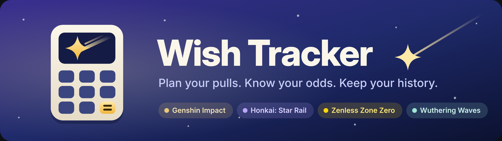
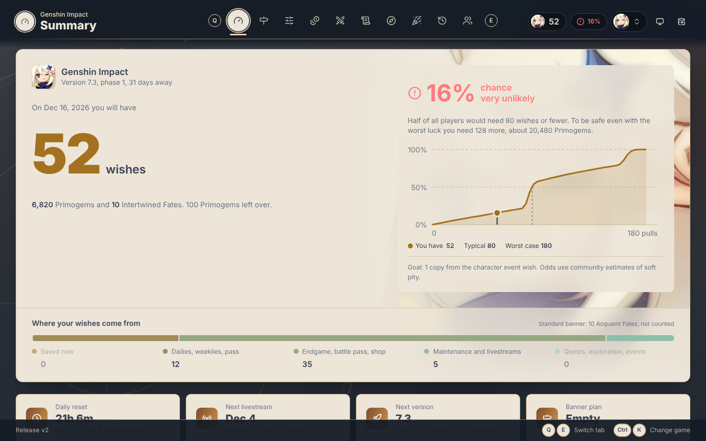
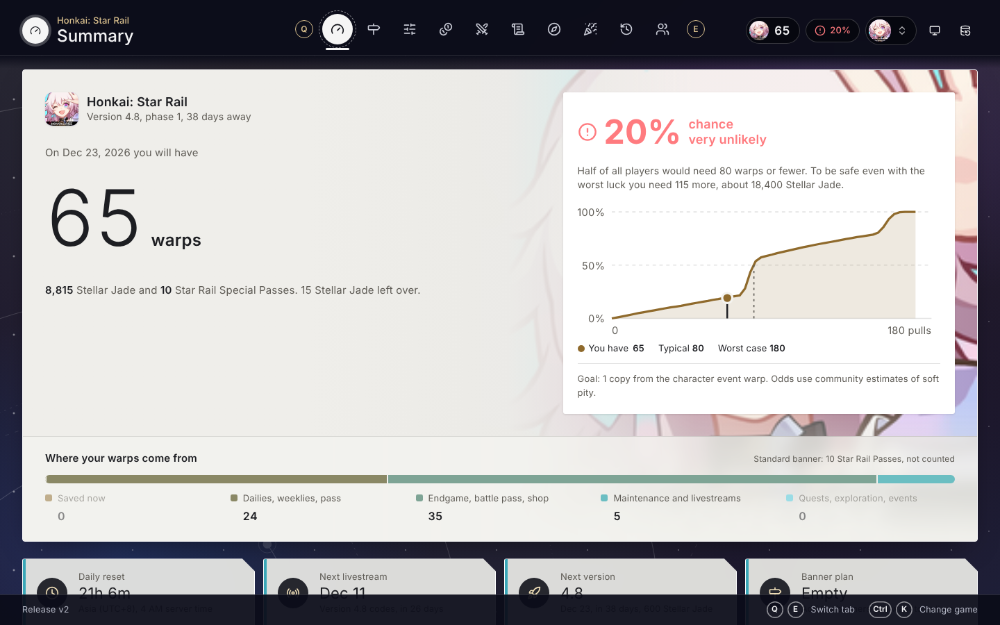
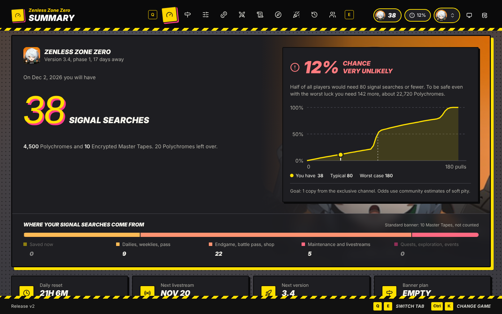
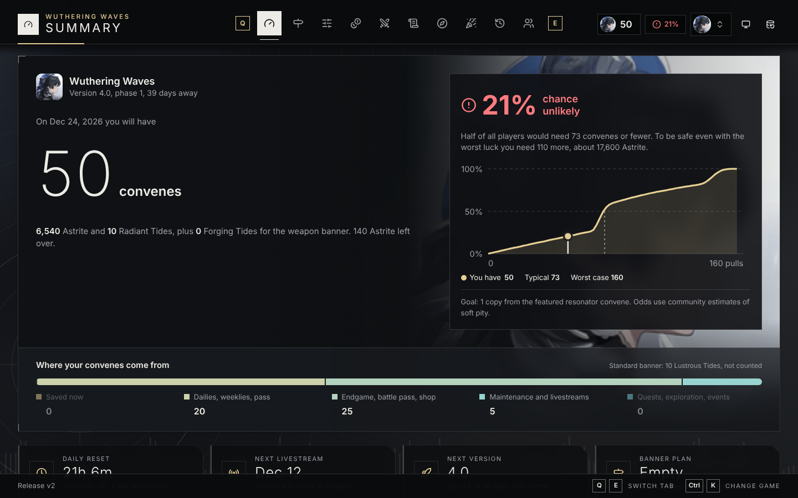

 

  

  
  
  

<h3 align="center">
  <a href="https://github.com/Amr-3009/wish-tracker/releases/latest">Download for Windows</a>
</h3>

  A desktop app for <b>Genshin Impact</b>, <b>Honkai: Star Rail</b>, <b>Zenless Zone Zero</b> and <b>Wuthering Waves</b>. 
  It tells you how many pulls you will have by the day you want to pull, how likely you are to get what you are saving for, 
  and what it takes to level them up once you have them.

---

## Four games, four looks

Each game gets its own theme, so the app feels like the game you are planning for.

| Genshin Impact | Honkai: Star Rail |
| :---: | :---: |
|  |  |
| **Zenless Zone Zero** | **Wuthering Waves** |
|  |  |

## What it does

| | |
| --- | --- |
| **Counts your pulls** | Adds what you have saved to everything you can still earn by your pull date: dailies, weeklies, the monthly pass, the battle pass, patch rewards, endgame modes, quests, exploration and events. |
| **Shows your chances** | The odds of getting each character or weapon in your banner plan, using pity and the 50/50, for one copy or several. |
| **Imports your history** | Finds your wish history on your PC and imports it, then fills in your pity for you. Also reads and writes UIGF and SRGF files from other trackers. |
| **Tracks your luck** | Every 5-star with the pull it came on, 50/50 wins and losses, and how your average compares with the expected one. |
| **Plans your level-ups** | Pick a character or weapon, where it is now and where you want it: level, ascension and every talent, trace, skill or Forte node. It lists every material, the EXP and the money that takes. |
| **Keeps your inventory** | Type in the materials you own. Spare lower tiers count toward higher ones at 3 to 1, and the app tells you exactly what to craft in the game and what you still need to farm. |
| **Knows the characters** | A browsable list of every character and weapon, with the ones you pulled marked by how many copies you have. One button refreshes it when a new version comes out. |
| **Follows the game's clock** | Daily and weekly resets, patch dates and livestreams for your server, with "done" switches that turn themselves off after a reset. |

## Plan a level-up

1. Open the **Level-up planner** tab and click **Add character or weapon**.
2. Set where it is now and where you want it. It starts at the maximum, so lower the targets you do not need.
3. Open the **Inventory** tab and type how many of each listed material you have. Only materials your plans use are listed, with every tier of each one.
4. Back on the planner, **Everything planned** adds all your plans together and shows what is short.

**Custom characters and weapons.** In the add list, pick **Custom character or weapon**, name it and choose its rarity: every character or weapon of one rarity costs the same amounts. Then fill each material slot (talent book, boss drop, gem and so on) by picking its picture. The black **?** is for a material that is not in the game yet: type its name and it gets its own box on the Inventory tab.

When spare lower tiers can cover a shortfall, the list says what to make, for example *Craft 9 Guide to Justice from 27 Teachings of Justice*. The numbers you typed are never changed. The cost of crafting itself (Mora, Credits, Dennies or Shell Credits) is not counted.

## Install

1. Open the [latest release](https://github.com/Amr-3009/wish-tracker/releases/latest).
2. Under **Assets**, download `Wish-Tracker-Setup-<version>.exe` and run it.
3. Windows shows a blue "Windows protected your PC" box, because the app is not signed with a paid certificate. Click **More info**, then **Run anyway**.

The app opens with a short tour. You can replay it any time from the menu in the top bar.

### Updates

You only install once. The app checks for a new release when it starts, downloads it in the background, and installs it the next time you restart. **Check for updates** in the top bar menu checks on demand.

## Import your wish history

1. Open the game on the same PC and go to its history page. Wait for the list to load.
2. In Wish Tracker, open the **Wish history** tab and click **Find link automatically**.
3. Click **Import**.

| Game | Where the history page is |
| --- | --- |
| Genshin Impact | Wish, then History |
| Honkai: Star Rail | Warp, then View Details, then Records |
| Zenless Zone Zero | Signal Search, then Details, then Signal Records |
| Wuthering Waves | Convene, then Convene History |

The link the game gives out expires after about a day, so open the history page again before each import. The games only keep the last six months; pulls you already imported stay in the app.

## Your data stays on your PC

- There is no account and no server. Nothing you enter is uploaded.
- Everything is saved in one file: `Documents\Wish Tracker\save.json`. Yesterday's copy sits beside it as `save.backup.json`.
- Updating or reinstalling the app does not touch that file.
- **Export backup** and **Import backup** in the top bar menu move your data to another PC.

The app does go online to download character pictures, fonts, the character database, banner data, level-up costs and updates, and to ask the game's own servers for your history when you import.

## Questions

<b>Is it safe to give the app my history link?</b>

 
The link only lets someone read your wish history. It cannot log in to your account, spend anything or change anything, and it expires after about a day. The app sends it to the game's own server and nowhere else.

<b>Why does Windows warn me about the installer?</b>

 
Windows shows that warning for any app whose publisher has not bought a code-signing certificate. It says the publisher is unknown, not that something was found.

<b>The 50/50 result for one of my pulls looks wrong.</b>

 
The oldest 5-star in an import cannot be judged, because the pulls before it are older than the six months the game keeps. It is shown with a "+" after its pull count and left out of the win and loss totals. If a different pull is wrong, please <a href="https://github.com/Amr-3009/wish-tracker/issues">open an issue</a> and say which game, character and date.

<b>Can I use it on a phone or a Mac?</b>

 
Not as an app. The installer is for Windows 10 and 11.

## Thanks

Wish Tracker stands on data that the community keeps up to date:

- [Lunaris](https://lunaris.moe) for Genshin Impact characters and weapons
- [nanoka](https://hsr.nanoka.cc) for Honkai: Star Rail, Zenless Zone Zero and Wuthering Waves, and the level-up costs of all four games
- [TurnBasedGameData](https://github.com/DimbreathBot/TurnBasedGameData) and [WutheringWaves_Data](https://github.com/Arikatsu/WutheringWaves_Data) for Star Rail and Wuthering Waves EXP tables
- [paimon.moe](https://paimon.moe) for Genshin Impact banner and event dates
- [Enka.Network](https://enka.network) for pictures and fallback data
- [UIGF](https://uigf.org) for the shared wish-history file format

---

  
    Wish Tracker is a fan-made tool. It is not affiliated with or endorsed by HoYoverse or Kuro Games. 
    Game names, characters and images belong to their owners.
  

